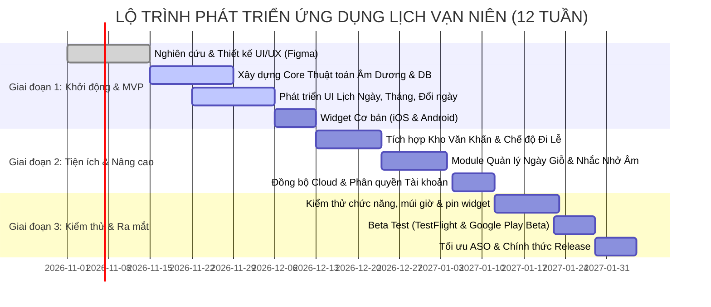

# BẢN KẾ HOẠCH PHÁT TRIỂN SẢN PHẨM: ỨNG DỤNG LỊCH VẠN NIÊN HIỆN ĐẠI
**Product Concept: An Lịch / Vạn Niên Đương Đại (Modern Oriental Calendar)**  
*Dành cho iOS & Android | Đóng vai trò: Product Manager & Lead UI/UX Designer*

---

## 1. ĐỊNH HƯỚNG GIAO DIỆN & TRẢI NGHIỆM (UI/UX DIRECTION)

### 1.1. Triết lý Thiết kế: "Neo-Heritage Minimalism" (Tối giản Đương đại & Bản sắc Á Đông)
* **Vấn đề của thị trường hiện nay:** Các ứng dụng Lịch Vạn Niên truyền thống thường mắc lỗi thị giác: giao diện quá rườm rà (màu đỏ gắt, viền rồng phượng mạ vàng, nhiều banner quảng cáo nhấp nháy), gây cảm giác cũ kỹ và ngột ngạt.
* **Định hướng đột phá:**
  * Tiếp cận theo phong cách **Neo-Heritage Minimalism**: Đơn giản, trang nhã, nhiều khoảng thở (whitespace/negative space), sử dụng typography hiện đại kết hợp đường nét hoa văn kỷ hà Á Đông được tinh giản hóa (họa tiết mây cuộn, cánh sen, vân gốm, sóng nước).
  * Đặt tính dễ đọc (readability) và trải nghiệm cảm xúc (emotional experience) lên hàng đầu.

### 1.2. Bảng Màu Phong Thủy & Tối Giản (Curated Feng-Shui Palette)
Không dùng màu đơn sắc thô ráp, hệ thống màu được pha trộn tinh tế:
* **Primary (Đỏ Chu Sa - Cinnabar Red `#C0392B` / Deep Crimson `#8F1D2C`):** Màu tượng trưng cho cát tường, may mắn, hỷ sự nhưng ở sắc độ matte trầm ấm, sang trọng.
* **Secondary (Vàng Hoàng Tộc - Imperial Sand/Gold `#D4AF37` / `#C5A059`):** Dùng làm điểm nhấn cho giờ Hoàng đạo, ngày tốt, biểu tượng vương giả.
* **Neutral Backgrounds (Chất cảm giấy Dó & Mực Tàu):**
  * *Light Mode (Giấy Dó Ấm):* Nền `#FAF8F5`, bề mặt card `#FFFFFF`, chữ mực đen than chì `#1C1D21`, đường viền thanh mảnh `#E8E4DD`.
  * *Dark Mode (Huyền Thạch / Obsidian Ink):* Nền `#111215`, card `#1B1C22`, chữ trắng ngà `#EDEAE5`.
* **Dynamic Ngũ Hành Accent:** Tùy biến màu nhấn theo hành Can Chi của ngày:
  * Kim (Trắng ngọc / Bạc `#94A3B8`)
  * Mộc (Xanh Lục Bảo `#2D6A4F`)
  * Thủy (Xanh Chàm Đậm `#1D3557`)
  * Hỏa (Đỏ Chu Sa `#C0392B`)
  * Thổ (Nâu Cát Trầm `#7F5539`)

### 1.3. Bố Cục Trang Chủ (Home Dashboard Layout)
* **Phần Đầu (Header):**
  * Hiển thị Thứ, Ngày Dương, Địa điểm & Nhiệt độ thời tiết nhẹ nhàng.
  * Nút chuyển đổi nhanh sang Xem Tháng và Bộ Đổi Ngày.
* **Hero Block (Lịch Ngày "Tờ Lịch Xé Đương Đại"):**
  * Số ngày Dương to bản, sắc nét ở vị trí trung tâm (Font Serif phong nhã hoặc Humanist Sans).
  * Khối ngày Âm lịch trang trọng ngay bên dưới: *Ngày (số) - Tháng (chữ) - Năm (Can chi)*.
  * Huy hiệu trạng thái: **[Ngày Hoàng Đạo]** (tag viền vàng kim) hoặc **[Ngày Hắc Đạo]**.
  * Một câu cách ngôn, lời dạy cổ nhân hoặc câu chúc an lành ngắn gọn dưới chân tờ lịch.
* **Thanh Tiến Trình Giờ Hoàng Đạo (Horizontal Timeline):**
  * Trục 12 giờ Can Chi (Tý, Sửu, Dần...) trực quan, các giờ Hoàng đạo được highlight nổi bật, bấm vào xem chi tiết ngay tức thì.
* **Bento Grid Tiện Ích Trong Ngày (Cards bo góc 16px):**
  * *Card 1:* Việc Nên làm / Kiêng cữ (Hôm nay nên: Khai trương, Xuất hành; Kiêng: Động thổ).
  * *Card 2:* Sự kiện tâm linh kế tiếp (Đếm ngược: "Còn 2 ngày nữa đến Rằm Tháng Giêng").
  * *Card 3:* Hướng xuất hành tốt (Hỷ Thần, Tài Thần).

### 1.4. Hiệu Ứng Chuyển Động & Tương Tác Vi Mô (Micro-interactions)
* **Lật Lịch Mượt Mà (Page-peel / Smooth Swipe):** Vuốt sang trái/phải để chuyển ngày với gia tốc vật lý tự nhiên (Spring physics) kèm phản hồi rung nhẹ (Haptic Feedback) như đang chạm vào chất liệu giấy thật.
* **Morphing Transition:** Chạm vào số ngày sẽ bung mượt mở rộng thành Lịch Tháng toàn màn hình.
* **La Bàn Phong Thủy Tương Tác:** Hiệu ứng quay êm ái khi người dùng tra cứu hướng xuất hành.

---

## 2. TÍNH NĂNG CỐT LÕI (CORE FEATURES)

| STT | Phân hệ tính năng | Mô tả chi tiết & Điểm khác biệt |
| :--- | :--- | :--- |
| **1** | **Lịch Âm - Dương Toàn Diện** | • Xem theo ngày (chi tiết) và theo tháng (tổng quan). • Hiển thị đầy đủ Can Chi (Giờ, Ngày, Tháng, Năm), Tiết khí trong năm. • Phân định rõ ràng Ngày Hoàng Đạo / Hắc Đạo, Trực nhật, Nhị thập bát tú. |
| **2** | **Bộ Đổi Ngày Siêu Tốc** | • Chuyển đổi 2 chiều Dương ↔ Âm tức thì bằng con lăn cuộn hoặc nhập trực tiếp. • Xem sự kiện lịch sử/khoảng cách ngày (còn bao nhiêu ngày nữa đến sự kiện). • Hiển thị ngay thông tin phong thủy của ngày được chuyển đổi. |
| **3** | **Tra Cứu Giờ Tốt & Việc Nên Làm** | • Danh sách 6 giờ Hoàng đạo trong ngày với diễn giải thời gian chính xác. • Gợi ý việc Nên làm / Không nên làm được diễn giải bằng ngôn ngữ hiện đại, dễ hiểu, tránh thuật ngữ cổ bí hiểm gây hoang mang. |
| **4** | **Kho Văn Khấn Cổ Truyền** | • Hệ thống bài văn khấn chuẩn mực: Rằm, Mùng 1, Lễ Tết (Giao thừa, Thần Tài, Táo Quân), Cúng gia tiên, Động thổ, Khai trương. • **Chế độ Đi Lễ (Reading Mode):** Giữ sáng màn hình, phông chữ lớn, nền ấm, danh sách đồ lễ cần chuẩn bị đi kèm dạng Checklist. |
| **5** | **Nhắc Nhở Lễ Giỗ & Sự Kiện Âm Lịch** | • Tự động nhắc nhở ngày Sóc (Mùng 1) và ngày Vọng (Rằm) trước 1 ngày. • **Quản lý Ngày Giỗ Gia Tiên:** Nhập ngày mất âm lịch 1 lần, hệ thống tự quy đổi ra ngày dương lịch hàng năm và gửi thông báo nhắc nhở sắm lễ trước 1 - 3 ngày. • Đồng bộ tùy chọn với Google Calendar / Apple Calendar. |
| **6** | **Hệ Thống Widget Ngoài Màn Hình** | • Hỗ trợ Widget đa dạng kích thước (Small, Medium, Large) trên cả iOS (WidgetKit) và Android (Glance/AppWidget). • Widget Khóa màn hình (Lockscreen) hiển thị ngày âm lịch tinh gọn. • Cập nhật tự động nửa đêm mà không gây hao pin. |

---

## 3. KIẾN TRÚC THÔNG TIN & LUỒNG NGƯỜI DÙNG (IA & USER FLOW)

### 3.1. Cấu Trúc Điều Hướng (Navigation Architecture)
Sử dụng **Bottom Navigation Bar với 4 Tab duy nhất**:
1. **Lịch Ngày (Trang chủ):** Tập trung vào tờ lịch ngày hiện tại, giờ tốt và việc trong ngày.
2. **Lịch Tháng:** Toàn cảnh 30 ngày, đánh dấu ngày rằm, mùng 1, ngày giỗ cá nhân và chấm màu phong thủy.
3. **Tâm Linh & Tra Cứu:** Văn khấn, Đổi ngày, La bàn phong thủy, Tử vi năm, Cung sao hoàng đạo.
4. **Sự Kiện & Cá Nhân:** Quản lý ngày giỗ, danh sách việc cần làm, nhắc nhở lễ cúng, Cài đặt & Sao lưu dữ liệu.

### 3.2. Tiêu Chuẩn Trải Nghiệm: "Quy Tắc Dưới 3 Lần Chạm"
* **Đổi Ngày Âm - Dương:**
  * *Chạm 1:* Nhấp icon Đổi Ngày trên Header Trang Chủ hoặc Tab Tra Cứu.
  * *Chạm 2:* Chọn ngày bằng picker.
  * Kết quả hiển thị tức thì (Real-time update) ngay bên dưới không cần bấm nút "Tính toán".
* **Đọc Văn Khấn Ngày Rằm / Mùng 1:**
  * Vào đúng ngày Rằm hoặc Mùng 1, Trang Chủ tự động xuất hiện Shortcut: *"Hôm nay là Rằm tháng... - Đọc bài khấn"*.
  * *Chạm 1:* Mở thẳng bài khấn tương ứng.
* **Tạo Lịch Nhắc Ngày Giỗ:**
  * *Chạm 1:* Tab Sự Kiện -> Bấm icon (+).
  * *Chạm 2:* Chọn loại "Lễ Giỗ (Âm lịch)" -> Nhập tên người quá cố & chọn ngày âm.
  * *Chạm 3:* Bấm "Lưu" (Hệ thống tự động kích hoạt chu kỳ lặp lại hàng năm vĩnh viễn).

---

## 4. GỢI Ý CÔNG NGHỆ (TECH STACK ARCHITECTURE)

### 4.1. Framework Ứng Dụng: Flutter vs React Native
* **Khuyến nghị số 1: FLUTTER (Dart)**
  * **Lý do chọn:**
    1. *Hiệu năng render đồ họa 60-120fps:* Công cụ đồ họa Impeller/Skia giúp hiệu ứng lật trang, cuộn timeline, chuyển động morphing mượt mà tuyệt đối không bị giật lag (frame drop).
    2. *Typography & Canvas tùy biến cao:* Dễ dàng vẽ các bố cục lịch phức tạp, chữ thư pháp hoặc các chi tiết đồ họa Á Đông đồng nhất 100% trên cả iPhone và các dòng máy Android phân mảnh.
    3. *Hỗ trợ Widget tuyệt vời:* Sử dụng thư viện `home_widget` kết hợp Swift (SwiftUI WidgetKit) và Kotlin (Jetpack Compose Glance) để tạo widget màn hình chính nhanh chóng.
  * *(Lựa chọn thay thế - React Native):* Thích hợp nếu đội ngũ đã có sẵn thế mạnh sâu về React/TypeScript và muốn tận dụng React Native New Architecture (Fabric, TurboModules) cùng Reanimated 3.

### 4.2. Thuật Toán Lịch & Xử Lý Ngày Âm
* Sử dụng **Thuật toán Thiên văn Hồ Ngọc Đức (Múi giờ GMT+7 Việt Nam)**:
  * Đã được chứng minh độ chính xác tuyệt đối từ năm 1800 đến 2199.
  * Tính toán chính xác các năm nhuận, tháng nhuận theo quy luật tuần hoàn mặt trăng và 24 tiết khí (Lập xuân, Vũ thủy, Thanh minh, Hạ chí...).
  * Xử lý trọn vẹn offline ngay trên thiết bị, không cần phụ thuộc vào API server bên ngoài.

### 4.3. Kiến Trúc Dữ Liệu & Hạ Tầng
* **Database Cục Bộ (Offline-First):** SQLite (qua `drift` hoặc `isar` trên Flutter) để lưu trữ kho bài văn khấn, dữ liệu ngày giỗ và nhật ký cá nhân. Ứng dụng hoạt động 100% tính năng cốt lõi ngay cả khi mất mạng.
* **Thông Báo (Notification Engine):** `flutter_local_notifications` lập lịch thông báo định kỳ chuẩn xác theo chu kỳ âm lịch đã quy đổi mà không tiêu tốn tài nguyên mạng.
* **Đồng Bộ Đám Mây (Cloud Sync):** Supabase (PostgreSQL + Auth) hoặc Firebase Auth/Firestore để người dùng đăng nhập bằng Apple ID / Google và tự động sao lưu dữ liệu ngày giỗ sang thiết bị mới.

---

## 5. LỘ TRÌNH TRIỂN KHAI (ROADMAP)

### Chi tiết các giai đoạn:

#### Giai đoạn 1: MVP Cốt Lõi (Tuần 1 - Tuần 5)
* Hoàn thiện Design System, Typography, Icon set văn hóa Á Đông tinh giản.
* Xây dựng engine tính âm dương lịch offline chuẩn xác 100%.
* Màn hình Lịch Ngày (Tờ lịch xé), Lịch Tháng, Bộ Đổi Ngày Âm Dương.
* Widget cơ bản hiển thị ngày âm dương trên Home Screen.

#### Giai đoạn 2: Trải Nghiệm Giá Trị & Tâm Linh (Tuần 6 - Tuần 9)
* Số hóa và phân loại 50+ bài văn khấn chuẩn phong tục cổ truyền.
* Tính năng Quản lý Ngày Giỗ Gia Tiên và tự động tính lịch nhắc nhở.
* Tính năng Nhắc nhở ngày Rằm, Mùng 1.
* Hệ thống đồng bộ đám mây (Cloud Backup) bảo toàn dữ liệu người dùng.

#### Giai đoạn 3: Tinh Chỉnh, Kiểm Thử & Ra Mắt (Tuần 10 - Tuần 12)
* Kiểm thử biên (Edge-case testing): Năm nhuận, múi giờ quốc tế, thiết bị cấu hình thấp.
* Tối ưu hóa mức tiêu thụ pin của Widget và Background Task.
* ASO (App Store Optimization): Chụp bộ screenshot giao diện cao cấp, video giới thiệu đậm chất thiền định/an yên.
* Phát hành chính thức trên App Store và Google Play Store.

---
*Kế hoạch được lập bởi Product Manager & Lead UI/UX Designer.*
