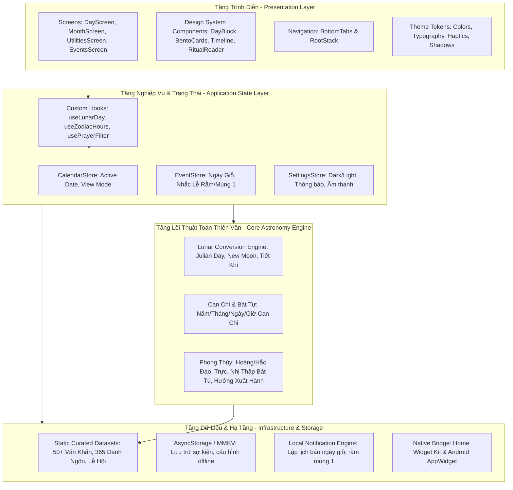

# HỒ SƠ KIẾN TRÚC HỆ THỐNG (SYSTEM DESIGN & ARCHITECTURE)
## ỨNG DỤNG LỊCH VẠN NIÊN HIỆN ĐẠI (AN LỊCH - NEO-HERITAGE CALENDAR)
*Dự án: Mobile App (iOS / Android / Web) | Framework: React Native (Expo SDK 52) + TypeScript*

---

## 1. TỔNG QUAN KIẾN TRÚC TỔNG THỂ (HIGH-LEVEL ARCHITECTURE)

Hệ thống được thiết kế theo mô hình **Clean Layered Architecture (Kiến trúc phân tầng sạch)** kết hợp nguyên lý **Offline-First**, đảm bảo 100% tính năng cốt lõi (tính âm dương, tra cứu phong thủy, đọc văn khấn) hoạt động độc lập không cần Internet.



---

## 2. CẤU TRÚC THƯ MỤC DỰ ÁN CHUẨN HÓA (DIRECTORY STRUCTURE)

Cấu trúc mã nguồn theo hướng **Feature-Driven & Modular**, tách biệt hoàn toàn giữa thuật toán lõi (Core Engine thuần TypeScript), Giao diện (UI) và Dữ liệu (Data):

```
lich-van-nien-app/
├── assets/                          # Tài nguyên đồ họa, icons, splash
│   ├── fonts/                       # Phông chữ tùy biến (Serif Á Đông, Inter/Be Vietnam Pro)
│   ├── icons/                       # Bộ icon phong cách Á Đông tối giản (SVG/PNG)
│   └── images/                      # Texture giấy Dó, minh họa lễ hội
│
├── src/
│   ├── core/                        # CORE ENGINE (100% Pure TypeScript - Không phụ thuộc UI)
│   │   ├── lunar/                   # Thuật toán thiên văn chuyển đổi Âm - Dương (Hồ Ngọc Đức)
│   │   │   ├── astronomy.ts         # Tính toán Julian Day, Kinh độ mặt trời, Điểm Sóc
│   │   │   ├── converter.ts         # API chuyển đổi: SolarToLunar, LunarToSolar
│   │   │   └── solarTerms.ts        # 24 Tiết khí trong năm (Lập xuân, Vũ thủy, ...)
│   │   ├── canchi/                  # Hệ Can Chi ngũ hành
│   │   │   ├── canChiCalculator.ts  # Tính Can Chi cho Năm, Tháng, Ngày, Giờ
│   │   │   └── elements.ts          # Ngũ hành nạp âm (Hải Trung Kim, Lư Trung Hỏa, ...)
│   │   ├── fengshui/                # Bát tự, Giờ Hoàng Đạo, Thập Nhị Bát Tú
│   │   │   ├── zodiacHours.ts       # 6 Giờ Hoàng đạo & 6 Giờ Hắc đạo theo ngày
│   │   │   ├── twelveDuties.ts      # 12 Trực (Kiến, Trừ, Mãn, Bình, ...) & Việc nên/tránh
│   │   │   ├── twentyEightStars.ts  # Nhị thập bát tú (28 sao chiếu mệnh)
│   │   │   └── departureDirections.ts # Hướng Tài Thần, Hỷ Thần, Hạc Thần
│   │   └── types/                   # Khai báo TypeScript types toàn bộ hệ thống
│   │       ├── lunar.types.ts
│   │       ├── fengshui.types.ts
│   │       ├── event.types.ts
│   │       └── prayer.types.ts
│   │
│   ├── data/                        # DỮ LIỆU ĐÓNG GÓI SẴN (OFFLINE CURATED DATA)
│   │   ├── prayers/                 # 50+ Bài văn khấn cổ truyền biên tập chuẩn mực
│   │   │   ├── index.ts
│   │   │   ├── lunarMonthly.ts      # Văn khấn Rằm, Mùng 1
│   │   │   ├── festivals.ts         # Văn khấn Tết Nguyên Đán, Thần Tài, Đoan Ngọ
│   │   │   └── ancestral.ts         # Văn khấn Lễ Giỗ, Cúng mụ, Động thổ
│   │   ├── quotes/                  # 365 câu danh ngôn, lời khuyên an yên mỗi ngày
│   │   └── holidays/                # Danh mục ngày lễ truyền thống & quốc tế
│   │
│   ├── theme/                       # DESIGN SYSTEM & THEME TOKENS
│   │   ├── colors.ts                # Bảng màu Đỏ Chu Sa, Vàng Hoàng Tộc, Giấy Dó, Slate
│   │   ├── typography.ts            # Thang tỷ lệ chữ, font family, line-height
│   │   ├── spacing.ts               # Khoảng cách 4px, 8px, 16px, 24px, 32px
│   │   └── haptics.ts               # Bộ rung xúc giác (Light, Medium, Selection)
│   │
│   ├── components/                  # THƯ VIỆN GIAO DIỆN TÁI SỬ DỤNG
│   │   ├── common/                  # Nút, Thẻ, Modal, Typography, Header
│   │   │   ├── Text.tsx
│   │   │   ├── Card.tsx
│   │   │   ├── Badge.tsx
│   │   │   └── CustomHeader.tsx
│   │   ├── calendar/                # Các thành phần chuyên dụng cho Lịch
│   │   │   ├── DayBlock.tsx         # Tờ lịch xé đương đại (Hero Component)
│   │   │   ├── MonthGrid.tsx        # Ma trận 30 ngày âm dương
│   │   │   └── DatePickerModal.tsx  # Bộ chọn ngày âm dương siêu tốc
│   │   ├── timeline/
│   │   │   └── ZodiacTimeline.tsx   # Trục 12 giờ Can Chi hoàng đạo
│   │   └── ritual/
│   │       ├── PrayerReader.tsx     # Trình đọc văn khấn chế độ Đi Lễ (Màn hình luôn sáng)
│   │       └── OfferingsList.tsx    # Checklist mâm lễ vật cần chuẩn bị
│   │
│   ├── screens/                     # MÀN HÌNH CHÍNH
│   │   ├── DayScreen.tsx            # Tab 1: Trang chủ - Lịch Ngày & Giờ Tốt
│   │   ├── MonthScreen.tsx          # Tab 2: Lịch Tháng & Ngày Hoàng Đạo
│   │   ├── UtilitiesScreen.tsx      # Tab 3: Văn Khấn, Đổi Ngày, La Bàn, Tử Vi
│   │   ├── EventsScreen.tsx         # Tab 4: Quản lý Ngày Giỗ, Nhắc Lễ, Cá Nhân
│   │   └── modals/
│   │       ├── PrayerDetailScreen.tsx
│   │       └── AddLunarEventModal.tsx
│   │
│   ├── store/                       # STATE MANAGEMENT (Zustand hoặc React Context)
│   │   ├── useCalendarStore.ts      # Quản lý ngày đang chọn, chế độ xem
│   │   ├── useEventStore.ts         # Danh sách ngày giỗ, sự kiện âm lịch cá nhân
│   │   └── useSettingsStore.ts      # Theme (Dark/Light), Cài đặt thông báo
│   │
│   ├── services/                    # DỊCH VỤ NỀN TẢNG
│   │   ├── storageService.ts        # Quản lý bộ nhớ cục bộ (AsyncStorage)
│   │   ├── notificationService.ts   # Lập lịch thông báo ngày giỗ, rằm, mùng 1
│   │   └── widgetService.ts         # Đồng bộ dữ liệu sang Widget Home/Lockscreen
│   │
│   └── utils/                       # HÀM BỔ TRỢ (HELPERS)
│       ├── dateUtils.ts             # Định dạng chuỗi ngày tháng tiếng Việt
│       └── shareUtils.ts            # Chụp ảnh tờ lịch ngày đẹp để chia sẻ mạng xã hội
│
├── App.tsx                          # Root Application Component
├── app.json                         # Cấu hình Expo, Icons, Splash, Permissions
└── tsconfig.json                    # Cấu hình TypeScript Strict Mode
```

---

## 3. THIẾT KẾ CÁC MÔ-ĐUN DỮ LIỆU CỐT LÕI (DATA MODELS)

### 3.1. Mô hình Ngày Âm - Dương & Phong Thủy (`LunarDayInfo`)
```typescript
export interface LunarDayInfo {
  // Dương lịch
  solar: {
    day: number;
    month: number;
    year: number;
    dayOfWeek: string; // "Thứ Hai", "Chủ Nhật"
    dayOfWeekShort: string; // "T2", "CN"
  };
  // Âm lịch
  lunar: {
    day: number;
    month: number;
    year: number;
    isLeapMonth: boolean; // Tháng nhuận
    monthName: string; // "Tháng Giêng", "Tháng Chạp"
  };
  // Can Chi
  canChi: {
    year: string;   // Ví dụ: "Bính Ngọ"
    month: string;  // Ví dụ: "Canh Dần"
    day: string;    // Ví dụ: "Giáp Tý"
    element: string;// Ngũ hành nạp âm: "Hải Trung Kim"
  };
  // Đánh giá ngày
  status: {
    isZodiacDay: boolean; // Ngày Hoàng Đạo (true) hay Hắc Đạo (false)
    zodiacName: string;   // "Thanh Long", "Kim Quỹ", "Câu Trận"...
    solarTerm: string;    // Tiết khí: "Lập Xuân", "Đại Hàn"...
    duty: string;         // Thập nhị trực: "Kiến", "Trừ", "Mãn"...
    star: string;         // Nhị thập bát tú: "Sao Giác", "Sao Phòng"...
  };
  // Khuyến nghị
  advice: {
    suitable: string[];   // ["Cúng tế", "Khai trương", "Xuất hành"]
    unsuitable: string[]; // ["Động thổ", "Chôn cất"]
    directions: {
      joyGod: string;     // Hướng Hỷ Thần: "Đông Nam"
      wealthGod: string;  // Hướng Tài Thần: "Tây Bắc"
    };
  };
}
```

### 3.2. Mô hình Giờ Hoàng Đạo (`HourZodiac`)
```typescript
export interface HourZodiac {
  branch: string;       // "Tý", "Sửu", "Dần"...
  solarTime: string;    // "23:00 - 00:59", "01:00 - 02:59"...
  isZodiac: boolean;    // true: Hoàng đạo | false: Hắc đạo
  zodiacName: string;   // "Thanh Long (Hoàng đạo)", "Thiên Hình (Hắc đạo)"
  statusText: string;   // "Rất tốt cho cầu tài, xuất hành"
}
```

### 3.3. Mô hình Quản lý Ngày Giỗ & Sự Kiện Âm Lịch (`LunarEvent`)
```typescript
export interface LunarEvent {
  id: string;
  title: string;              // "Giỗ Cụ Nội", "Sinh nhật Bà Ngoại"
  category: 'death_anniversary' | 'birthday' | 'custom_prayer' | 'reminder';
  lunarDay: number;           // Ngày âm: 15
  lunarMonth: number;         // Tháng âm: 7
  isLeapMonthApplicable?: boolean;
  remindDaysBefore: number[]; // [1, 3]: Nhắc trước 1 ngày và 3 ngày
  remindTime: string;         // "08:00"
  notes?: string;             // Danh sách đồ cúng, phân công người làm
  createdAt: number;
}
```

### 3.4. Mô hình Bài Văn Khấn (`PrayerItem`)
```typescript
export interface PrayerItem {
  id: string;
  title: string;          // "Văn khấn Thần Linh và Gia Tiên ngày Rằm và Mùng 1"
  category: 'monthly' | 'tet' | 'ancestor' | 'temple' | 'construction';
  occasion: string;       // "Dùng cho ngày 1 và ngày 15 âm lịch hàng tháng"
  offerings: string[];    // ["Hương, hoa tươi", "Trầu cau", "Trái cây ngũ quả", "Nước sạch"]
  content: string[];      // Các đoạn văn khấn chuẩn mực
  tags: string[];         // ["Gia Tiên", "Rằm", "Mùng Một"]
}
```

---

## 4. CHIẾN LƯỢC QUẢN LÝ TRẠNG THÁI & HIỆU NĂNG (STATE & PERFORMANCE)

1. **Memoization & Cache Calculation:**
   * Các phép tính thiên văn Julian Day và Can Chi được cache theo khóa `YYYY-MM-DD`. Mỗi ngày chỉ tính toán 1 lần duy nhất trong phiên làm việc.
2. **Offline-First Storage:**
   * Sử dụng `AsyncStorage` (hoặc `react-native-mmkv` cho tốc độ I/O nhanh gấp 30 lần) để lưu trữ cấu hình người dùng và danh sách sự kiện cá nhân.
3. **Optimized Render Tree:**
   * Tách nhỏ các component tại `DayScreen` (Header, DayBlock, Timeline, BentoCards) với `React.memo` để khi người dùng vuốt chuyển ngày, chỉ tờ lịch và timeline cập nhật mượt mà, không giật lag.

---

## 5. BƯỚC ĐẦU TIÊN: LẬP TRÌNH BỘ CORE ENGINE THIÊN VĂN
Bước đầu tiên chúng ta sẽ triển khai ngay là xây dựng thư mục `src/core/` chứa thuật toán chuyển đổi Âm - Dương chuẩn thiên văn Việt Nam (Hồ Ngọc Đức) và bộ tính Can Chi, Giờ Hoàng Đạo.
